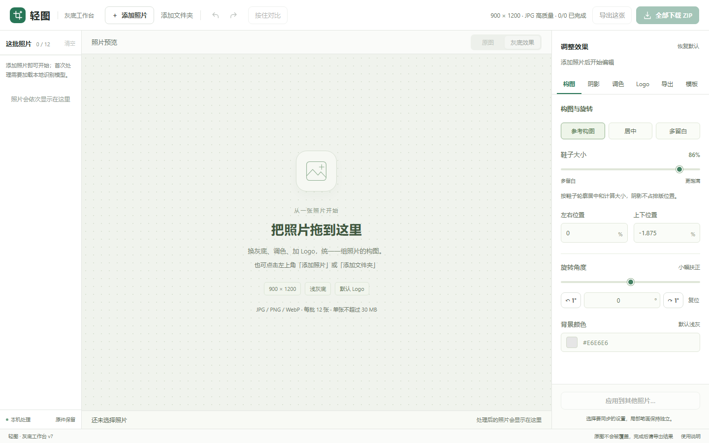

# 轻图 · 灰底工作台

**离线批量制作电商商品灰底图：AI 自动抠图，保留原图阴影，一键导出分层 PSD**

*Offline batch tool for e-commerce product photos: AI background removal that keeps the real ground shadow, with layered PSD export.*

中文 | [English](#english)

## 为什么做这个工具

跨境电商（Ozon、Wildberries、亚马逊等）上架商品，每个款都要做一组统一规格的灰底图或白底图。手工在 Photoshop 里抠图、补阴影、对齐、加 Logo，一组图要半小时左右。

这个工具把这些重复操作自动化了：**一组图从约 30 分钟缩短到约 10 分钟**，剩下的时间只需要检查和微调。最初是为鞋类商品图做的，在真实的电商团队里用过一整个换季。

## 亮点

- 🤖 **AI 自动抠图**：基于 [BiRefNet](https://github.com/ZhengPeng7/BiRefNet)。识别两次，先找到商品，再放大商品区域精修边缘
- 🌗 **保留真实阴影**：不是生成假阴影，而是从原图里提取落地阴影，可调范围、深浅、柔和度，还能用画笔擦掉多余部分
- 📐 **统一构图**：默认 900 × 1200、#E6E6E6 灰底，按商品轮廓自动居中、等比缩放，整批风格一致
- 🎨 **只调商品颜色**：亮度、对比度、色温、饱和度，不影响背景和阴影
- 🏷️ **Logo 和品牌模板**：上传透明 PNG Logo，常用设置存成模板，下次一键套用
- 📦 **分层 PSD 导出**：同款多个角度导出到一个 PSD，商品、阴影、Logo、背景各自分层，带可编辑蒙版，可以继续在 Photoshop 里修
- 💾 **自动保存，刷新不丢**：本批照片、设置和阴影笔画自动保存在本机，刷新或重启后自动恢复
- ⚡ **识别结果缓存**：处理过的照片再次载入只需几秒，不用重新跑模型；切到其他窗口也会继续处理
- 📚 **一批最多 60 张**：内存里只保留最近使用的 12 张完整数据，大批量也不卡
- 🔍 **原图 / 成片拖动对比**：一条分割线左右拖，鞋边和阴影处理得好不好一眼看清
- 🗂️ **为批量设计的界面**：两列缩略图带状态标记、“只看需检查”筛选、顶部进度和预计剩余时间
- 🔒 **完全离线**：不联网、不上传，照片只在本机处理
- 🖱️ **零安装**：解压后双击即可，不用装 Python、Node.js 或 Photoshop

## 快速开始

1. 到 [Releases](https://github.com/mrrobt095/qingtu-gray/releases/latest) 下载最新的 `qingtu-gray-*-win-x64.zip`（已包含运行环境和识别模型）
2. 右键压缩包 →「全部解压缩」
3. 打开解压后的文件夹，双击 **`启动工具.cmd`**，工具会自动在浏览器里打开
4. 把照片或文件夹拖进页面，逐张检查、微调后导出

系统要求：Windows 10 / 11，64 位。识别只用 CPU，不需要独立显卡。

详细操作见 [使用说明.txt](使用说明.txt)。

## 功能一览

| 模块 | 能做什么 |
|---|---|
| 构图 | 参考构图 / 居中 / 多留白，商品大小、位置、旋转（0.1° 精度） |
| 阴影 | 仅保留落地阴影 / 保留原图阴影 / 无阴影；范围、深浅、柔和度；画笔擦除与恢复 |
| 调色 | 亮度、对比度、色温、饱和度，随时恢复原色 |
| Logo | 内置示例 Logo，可上传自己的 PNG，独立调整位置、大小、透明度 |
| 模板 | 保存常用设置，最多 20 个模板、12 个 Logo |
| 导出 | 单张 JPG / PNG、整批 ZIP、整组分层 PSD（含成片，每组最多 12 张） |
| 批量 | 每批最多 60 张；自动保存与恢复；已识别的照片几秒内重新载入 |
| 编辑 | 撤销 / 重做 30 步、原图 / 成片拖动对比（C）、按住对比上次修改、100% / 200% 放大检查 |

## 隐私

- 工具只在本机运行一个服务，只监听 `127.0.0.1`，外部无法访问
- 识别模型和运行环境都打包在文件夹里，处理照片时不联网
- 原照片不会被修改或覆盖

## 常见问题

**能处理鞋子以外的商品吗？**
识别模型是通用的，包、服装、小家电这类主体清楚的商品一般都能抠。构图和阴影参数是按鞋类调的，其他品类可能需要手动调整。

**处理一张要多久？**
取决于电脑配置。在一台普通办公电脑上，新照片每张约 30 秒（含两次识别）；识别过的照片再次载入每张只需几秒。

**为什么不直接用在线抠图网站？**
商品图往往还没上架，不方便上传到第三方。在线工具一般也不保留真实阴影，不能批量统一构图，更不能导出分层 PSD。

## 从源码运行

仓库里不包含运行环境和识别模型（单个文件超过 GitHub 的 100 MB 限制）。直接用 Release 安装包最省事；想从源码运行的话：

1. **Node.js**：下载 Node.js v24 Windows x64 版，把 `node.exe` 放到 `runtime/node.exe`
2. **ONNX Runtime**：在 `runtime/` 目录下执行 `npm install onnxruntime-node@1.22.0`
3. **识别模型**：下载 [BiRefNet-general-bb_swin_v1_tiny-epoch_232.onnx](https://github.com/ZhengPeng7/BiRefNet/releases/download/v1/BiRefNet-general-bb_swin_v1_tiny-epoch_232.onnx)，重命名为 `birefnet-tiny.onnx`，放到 `models/`（校验信息见 [models/model-info.json](models/model-info.json)）
4. 双击 `启动工具.cmd`，或执行 `runtime/node.exe server.cjs`

### 代码结构

| 文件 | 作用 |
|---|---|
| `server.cjs` | 本机服务：提供页面、调用识别模型、保存品牌模板 |
| `native-inference.cjs` | 识别模型的后台线程（ONNX Runtime，CPU） |
| `inference.js` | 抠图：两次识别、主体筛选、生成蒙版 |
| `session.js` | 本机存储：识别结果缓存、批次自动保存与恢复（IndexedDB） |
| `processing.js` | 阴影提取、调色、构图与合成 |
| `editor.js` / `app.js` | 画布编辑与界面逻辑 |
| `psd-export.js` / `psd-worker.js` | 分层 PSD 导出 |

## 参与贡献

欢迎提 [Issue](https://github.com/mrrobt095/qingtu-gray/issues) 反馈问题或建议，也欢迎提交 Pull Request。反馈抠图效果问题时，附上一张示例照片会很有帮助（请勿上传涉及他人版权或未公开商品的图片）。

## 致谢

- [BiRefNet](https://github.com/ZhengPeng7/BiRefNet)：抠图识别模型
- [ONNX Runtime](https://github.com/microsoft/onnxruntime)：本地推理
- [Konva](https://github.com/konvajs/konva)：画布编辑
- [ag-psd](https://github.com/Agamnentzar/ag-psd)：PSD 导出
- [pako](https://github.com/nodeca/pako)、[base64-js](https://github.com/beatgammit/base64-js) 等

各组件的许可证见 [THIRD_PARTY_NOTICES.txt](THIRD_PARTY_NOTICES.txt) 和 `licenses/` 文件夹。

## 许可证

[MIT](LICENSE)。如果这个工具帮你省了时间，欢迎点个 ⭐，让更多做电商的朋友看到。

---

## English

**Qingtu Gray Studio** is an offline Windows tool for batch-producing uniform gray-background (or any solid color) e-commerce product photos. It was built for footwear listings on cross-border marketplaces and cut the time per photo set from about 30 minutes to about 10.

### Highlights

- **AI background removal** with [BiRefNet](https://github.com/ZhengPeng7/BiRefNet), run twice: once to find the product, once on the zoomed-in crop for cleaner edges
- **Keeps the real ground shadow** extracted from the original photo instead of faking one; adjustable range, strength and softness, plus a brush to erase stray shadow
- **Consistent framing**: 900 × 1200 on #E6E6E6 by default, auto-centered and scaled by the product outline
- **Product-only color correction**: brightness, contrast, temperature, saturation
- **Logo and brand templates** for repeatable output
- **Layered PSD export**: product, shadow, logo and background on separate layers with editable masks, several angles in one file
- **100% offline and private**: the local server only listens on `127.0.0.1`; nothing is uploaded
- **Auto-save and recognition cache**: the batch, settings and brush strokes survive a refresh or restart, and photos already recognized reload in seconds
- **Up to 60 photos per batch**, with memory kept in check by holding full working data for only the 12 most recent
- **Before/after split slider** (key C) that overlays the original photo in exactly the output framing
- **Batch-friendly UI**: two-column thumbnail grid with status badges, a "needs review" filter, and a progress bar with time remaining
- **No install**: unzip and double-click, no Python, Node.js or Photoshop required

### Quick start

1. Download `qingtu-gray-*-win-x64.zip` from [Releases](https://github.com/mrrobt095/qingtu-gray/releases/latest) (runtime and model included)
2. Unzip it, open the folder and double-click **`启动工具.cmd`** (“Start tool”)
3. Drag photos or a folder into the page, review, adjust, export

Requires Windows 10 / 11 x64. Inference runs on the CPU; no GPU needed. The interface is in Chinese.

### Run from source

The runtime and model are not in the repository (files exceed GitHub's 100 MB limit). Put Node.js v24 x64 `node.exe` at `runtime/node.exe`, run `npm install onnxruntime-node@1.22.0` inside `runtime/`, download the [BiRefNet tiny ONNX model](https://github.com/ZhengPeng7/BiRefNet/releases/download/v1/BiRefNet-general-bb_swin_v1_tiny-epoch_232.onnx) to `models/birefnet-tiny.onnx`, then run `runtime/node.exe server.cjs`.

### License

[MIT](LICENSE). Third-party components are listed in [THIRD_PARTY_NOTICES.txt](THIRD_PARTY_NOTICES.txt). If this tool saves you time, a ⭐ helps others find it.
